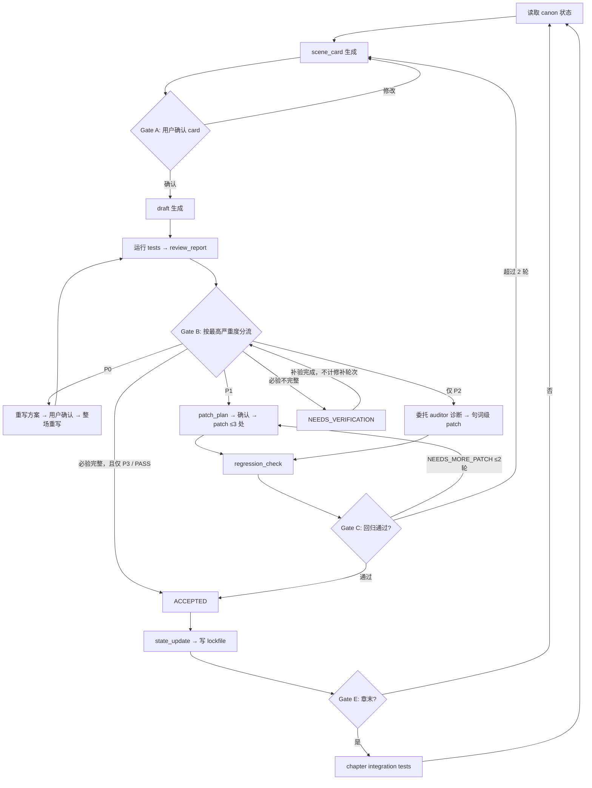

# Novel CI — 骨架设计蓝图

> 本文档是 `novel-ci` skill 的架构基准。交付对象:负责编写各工作包(WP)的执行代理。
> 阅读顺序:本文 → `contracts.md`(规范契约)→ 你所属 WP 的 goal brief(`goals/wp*.md`)→ `test-catalog.md`(仅 WP4/WP6 必读)。
> 冲突裁决:goal brief 与本文冲突时,以 `contracts.md` 为准;`contracts.md` 未覆盖时,以本文为准。

---

## 1. 系统一句话定义

> **Novel CI 是一套规格驱动的小说写作流程:用 scene_card 控制生成,用 tests 定位失败,用 patch 限制修改,用 regression 防止漂移,用 lockfile 维护长篇连续性。**

四条铁律:

```text
失败要可定位。
修改要有限权。
修完要回归。
正典要持续更新。
```

## 2. 架构决策(已定,不接受 WP 层面翻案)

| # | 决策 | 理由 |
|---|------|------|
| D1 | 单一 `novel-ci` skill,内部 `references/` 分模块 | 用户已确认。单入口路由,按流程阶段惰性加载模块文件 |
| D2 | 方法论与项目状态彻底分离 | skill 只含方法论;所有作品相关文件(bible、lockfile、正文)存放在**小说项目目录**,由 `state-layout` 契约定义。沿用 novel-expander maintainer notes 的分层原则,skill 跨项目复用 |
| D3 | anti-ai-patterns 只保留 expander 一份正文 | 语言层规则委托给 sibling skills:draft 语言规则 → `novel-expander`;P2 文本诊断 → `novel-auditor`。委托契约与 fallback 见 `contracts.md` §10 |
| D4 | 取消 0—5 评分制,只保留 PASS / FAIL / RISK + P0—P3 | 原稿自己论证过"评分只能告诉你强弱,不能告诉你是否阻断";scores 与 test_results 双轨冗余,且模型打分噪音大。"低于 4 分必须进 failures"等价于"FAIL 即 failures" |
| D5 | schema 内嵌于 owner 模块文件,不设独立 `schemas/` 目录 | schema 是格式约定而非机器校验对象;独立目录必然产生双份维护漂移。每个 schema 有唯一 owner 文件(见 §5 归属表) |
| D6 | 12 个检查模块物理合并为 4 个 checks 文件 | 按"加载时机 + 所需上下文"聚类,而非一模块一文件(减少文件数但保持逻辑模块独立,每个模块仍独立输出结果) |
| D7 | RISK 必须有去向:落入 lockfile 的 `watchlist` | 原稿的 RISK 输出后无人跟进,是流程漏洞。watchlist 条目在下一场 review 时强制带入检查 |
| D8 | patch 循环上限 2 轮 | 同一场景 review→patch→regression 循环超过 2 轮仍 NEEDS_MORE_PATCH,判定为场景规划问题,强制回到 planning 阶段。防止无限修补 |
| D9 | 提供 lite 初始化模式 | 全套 bible 冷启动成本过高会导致流程弃用。lite 模式定义最小必需状态集,允许边写边补 |
| D10 | 明确用户交互点 + auto 模式 | 默认在 card 确认、patch_plan 确认处停;用户要求连续写作时仅在 P0 处停。见 `contracts.md` §6 |
| D11 | 结构规格与叙事呈现分层 | novel-ci 拥有 scene_card 与发展性检查;`novel-expander/references/narrative-craft.md` 拥有如何把规格落实为场景/简述、行动、对话、POV、背景与细节的程序。不得新建第二个 developmental auditor |

## 3. 对外部原稿的修正清单

WP 作者注意:你手里若有外部原稿,以下差异**以本包为准**。

1. 原稿 `references/` 里的 project-brief.md、character-bible.md、world-bible.md、canon-lockfile.md、timeline.md、open-threads.md、style-guide.md、prose-benchmark.md、character-voice-samples.md **全部移出 skill**——它们是项目实例文件,归入状态目录契约(D2)。
2. `timeline.md` 与 `open-threads.md` **并入 lockfile**(lockfile schema 本就含 `timeline_position`、`open_threads`,独立文件是重复)。
3. `schemas/` 目录取消(D5);其中 `draft-request.yaml`(scene_card 即 draft request)与 `failure-report.yaml`(failure 是 review_report 内嵌条目)**删除**。
4. review_report 的 `scores` 块删除(D4);信息投放归 scene-function 测试。叙事呈现不设分数,由 checks-structure 内独立 `narrative_delivery` 模块做 PASS/FAIL/RISK 判断。
5. `prose-lint.md` 不作为 checks 文件存在——P2 检查委托 `novel-auditor`(D3)。
6. 原稿 `workflows/` 的 9 个文件重组为 8 个(见 §5;self-review 并入 workflow-review,scene-planning 与 chapter-planning 合并)。
7. 新增原稿没有的:watchlist(D7)、循环上限(D8)、lite 模式(D9)、交互点(D10)、failure location 格式定义、门禁总表(Gate A—E)。
8. 原稿第十五~十九章的 `/scene` `/draft` `/review` `/patch` `/regression` 模板不再作为独立 prompt 模板交付——它们的内容吸收进对应 workflow 文件,入口统一由 SKILL.md 路由。

## 4. 最终文件树(skill 本体)

```text
novel-superpower/user/novel-ci/
  SKILL.md                      # WP1 — 入口:触发、路由、流程总图、门禁表、模块加载规则
  references/
    conventions.md              # WP2 — 严重度、测试输出协议、patch 权限、门禁、交互点
    state-layout.md             # WP2 — 项目状态目录契约 + 状态对象 schema(brief/bible/character/lockfile)
    workflow-setup.md           # WP3 — 项目初始化(full + lite 双模式)
    workflow-state-update.md    # WP3 — 场景 ACCEPTED 后的 lockfile 更新流程 + state_update schema
    workflow-planning.md        # WP4 — 章节规划 + 场景规划 → scene_card(owner: scene_card/chapter_arc schema)
    workflow-chapter.md         # WP4 — 章节集成测试 + 章末收口
    workflow-draft.md           # WP5 — draft 生成协议(结构层规则 + 委托 expander 语言层)
    workflow-review.md          # WP6 — 测试执行编排 → review_report(owner: review_report schema)
    checks-canon.md             # WP6 — canon + continuity + information 三模块
    checks-character.md         # WP6 — character 通用层 + 角色专属层
    checks-structure.md         # WP6 — scene-function + causality + conflict + emotion-curve + consequence + narrative-delivery
    checks-genre.md             # WP6 — genre 契约测试 + 类型扩展包
    workflow-patch.md           # WP7 — patch 协议(owner: patch_note/patch_plan schema)
    workflow-regression.md      # WP7 — 回归检查(owner: regression_report schema)
```

另有两个 **delta 交付**(修改现有文件,不新建 skill):

- WP5:`novel-expander/SKILL.md` 增加 scene_card 输入模式与路由边界更新。
- WP7:`novel-auditor/SKILL.md` 增加 CI 调用模式(输出映射为 CI failure 格式)与路由边界更新。

## 5. 模块归属与加载规则

### 5.1 checks 聚类逻辑(D6)

| 文件 | 内含逻辑模块 | 聚类理由 | 所需上下文 |
|------|------------|---------|----------|
| checks-canon.md | canon_tests, continuity_tests, information_tests | 三者都是"对照 lockfile 的事实性核查" | lockfile + world_bible |
| checks-character.md | general_character_tests, character_specific_tests | 需完整加载出场角色的 character_profile | characters/*.yaml |
| checks-structure.md | scene_function, causality, conflict, emotion_curve, consequence, narrative_delivery | 六者只看 scene_card + draft 本身,不需外部状态 | scene_card + draft |
| checks-genre.md | genre_tests + 各类型扩展 | 按 project_brief.genre 选择性加载扩展段 | project_brief |

每个逻辑模块**独立输出**自己的 `*_tests_result` 块;物理合并只为减少文件数。

### 5.2 schema 唯一归属表(D5)

| Schema | Owner 文件 | 消费者 |
|--------|-----------|--------|
| project_brief / world_bible / character_profile / canon_lockfile | state-layout.md | 全部模块(只读),workflow-state-update(写) |
| scene_card / chapter_arc | workflow-planning.md | draft、review、chapter |
| review_report(含 failure/risk 条目格式) | workflow-review.md | patch、regression |
| patch_note / patch_plan | workflow-patch.md | regression |
| regression_report | workflow-regression.md | state-update |
| state_update | workflow-state-update.md | —(终端产物) |

消费者文件**不得复制** schema 全文,只允许:引用 owner 文件名 + 列出自己实际读写的字段名清单。

### 5.3 SKILL.md 的加载路由(WP1 实现)

按流程阶段惰性加载,任一时刻在上下文中的模块文件应 ≤ 3 个:

```text
初始化      → conventions + state-layout + workflow-setup
规划        → conventions + workflow-planning
写正文      → workflow-draft (+ sibling expander 规则)
自审        → workflow-review + 按需逐个加载 checks-*
修补        → workflow-patch (+ P2 时 sibling auditor)
回归        → workflow-regression
状态更新    → workflow-state-update + state-layout
章节收口    → workflow-chapter
```

## 6. 流水线总图



门禁的规范定义在 `contracts.md` §5,以该表为准。

## 7. 与 sibling skills 的关系

```text
novel-ci        — 流程与结构层:规格、测试、修改限权、状态维护(本包交付)
novel-expander  — 叙事呈现与语言生成层:narrative-craft + anti-AI 文风规则的 canonical 持有者
novel-auditor   — 语言诊断层:P2 检查引擎,最小修改 + 疑似标记原则
```

- draft 阶段:novel-ci 管**写什么/不能写什么**(scene_card 约束),expander 管变化如何落成场景以及句段如何实现(narrative craft + 语言规则)。
- review 阶段:checks-* 管 P0/P1 结构问题,auditor 管 P2 语言问题。
- P3 防线:auditor 的"作者意图优先/疑似不自动修"原则与 P3"默认不改"同源——审美偏好不自动升级；已确认语言问题需处理，必验缺失以 NEEDS_VERIFICATION 阻止虚假验收。
- fallback:sibling 不可用时降级执行,规则见 `contracts.md` §10。

## 8. WP 划分与构建顺序

| WP | 交付物 | 依赖 | 可并行性 |
|----|--------|------|---------|
| WP2 | conventions.md, state-layout.md | contracts.md(转写) | 先行,其余 WP 的术语基准 |
| WP3 | workflow-setup.md, workflow-state-update.md | WP2 术语 | WP3—WP7 互相并行 |
| WP4 | workflow-planning.md, workflow-chapter.md | WP2 术语, test-catalog §13 | 并行 |
| WP5 | workflow-draft.md + expander delta | WP2 术语 | 并行 |
| WP6 | workflow-review.md, checks-*.md ×4 | WP2 术语, test-catalog 全文 | 并行 |
| WP7 | workflow-patch.md, workflow-regression.md + auditor delta | WP2 术语 | 并行 |
| WP1 | SKILL.md | 全部文件名与接口(已在 contracts 冻结,可并行起草) | 最后校对收口 |

所有接口已在 `contracts.md` 冻结:WP 之间**不需要互相等待内容完成**,只需遵守契约。任何 WP 发现契约缺陷,反馈给包维护者修订 contracts.md,不得自行在自己文件里"就地修正"。

## 9. 每个 WP 的通用红线

1. **语言分层惯例**:meta 层(流程结构、路由、加载规则、maintainer notes)用英文;content 层(测试条目、案例、正文规则、中文写作相关的一切)用中文。理由见 novel-expander maintainer notes——中文创作时英文 meta 规则不触发。
2. **三层规则哲学**:除 conventions.md 里明确标注的硬门禁(P0/P1 gate)外,不得新增"违反一次即失败"的硬规则。密度类、风格类规则一律写成"警戒线 + 停下自查",防止防御性回避模式劣化输出。
3. **单一事实源**:不复制其他文件的 schema 或规则全文;引用文件名 + 节号。
4. **文件预算**:SKILL.md ≤ 150 行;每个 reference 文件目标 120—280 行,超 300 行须拆分或删减。
5. **不引入项目实例内容**:任何具体作品、角色名、题材设定不得进入 skill 文件;示例一律用抽象占位(角色 A、事件 X)。
